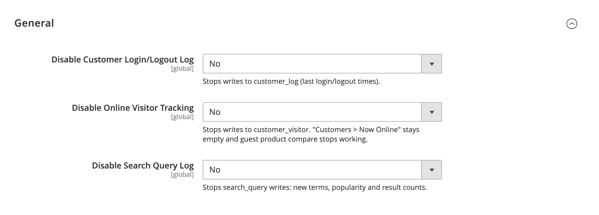

# DmLab_DisableLog

> Per-source admin toggles to switch off Magento's high-frequency core logging.

[](https://github.com/dmlab-work/module-disable-log/actions/workflows/ci.yml) [](https://codecov.io/gh/dmlab-work/module-disable-log) [](https://packagist.org/packages/dmlab/module-disable-log) [](https://packagist.org/packages/dmlab/module-disable-log) [](https://packagist.org/packages/dmlab/module-disable-log) [](LICENSE) 



## The problem
Magento writes to the database on ordinary page loads to log customer logins,
track online visitors and count search queries — per-request `INSERT`/`UPDATE`s
and tables that keep growing. This module stops those writes per source.

**Safe to turn off visitor tracking.** Magento's own check that logs out a customer's
other sessions after a password change or reset reads `customer_visitor`. Simply skipping
those writes silently disables it, so a stolen session survives a password reset. This module
keeps that protection working.

## Install
```bash
composer require dmlab/module-disable-log
bin/magento setup:upgrade
```
Magento 2.4.9+, PHP 8.3–8.5.

## Configuration

**Stores → Configuration → DMLab → Disable Log** (default scope, ACL `DmLab_DisableLog::config`).

| Toggle | Config path | Stops |
|---|---|---|
| Disable Customer Login/Logout Log | `dmlab_disable_log/general/disable_customer_log` | `customer_log` writes (last login/logout times) |
| Disable Online Visitor Tracking | `dmlab_disable_log/general/disable_visitor_log` | `customer_visitor` writes |
| Disable Search Query Log | `dmlab_disable_log/general/disable_search_log` | `search_query` writes (new terms, popularity, result counts) |

All toggles default to **No**: installing the module changes nothing until an
admin enables a source. Each toggle is independent and reversible — switching it
back to **No** restores stock logging.

Toggles apply to every area (storefront, admin, API). From the CLI:

```bash
bin/magento config:set dmlab_disable_log/general/disable_visitor_log 1
```

## Side effects

- **Customer log** — "Last Logged In" and online status in the admin customer view stop updating.
- **Visitor tracking** — **Customers → Now Online** stays empty; guest "Add to Compare"
  stops working (only logged-in customers can compare); guest recently viewed/compared
  lose their `visitor_id` link and guest rows without an owner are no longer written to
  `report_viewed_product_index` / `report_compared_product_index`; the admin customer view
  shows **Online** until logout. Password change/reset still logs out the customer's other
  sessions (cutoff checked against the login time kept in the session).
- **Search log** — new search terms are no longer recorded; **Marketing → SEO & Search →
  Search Terms**, **Reports → Search Terms** and popular search terms stop updating.

## How it works

`around` plugins on the core writers return early when their toggle is on;
no core class is patched or replaced:

- `Magento\Customer\Model\Logger::log()`
- `Magento\Customer\Model\ResourceModel\Visitor::save()`
- `Magento\Reports\Model\ResourceModel\Product\Index\AbstractIndex::save()` (rows with no visitor/customer)
- `Magento\Search\Model\Query::saveIncrementalPopularity()` and `saveNumResults()`

A customer session validator applies the password-change session cutoff to sessions
that have no `customer_visitor` row (also after visitor tracking is re-enabled).

## Tests
Unit: `vendor/bin/phpunit -c Test/Unit/phpunit.xml`.

## License

[OSL-3.0](LICENSE)
